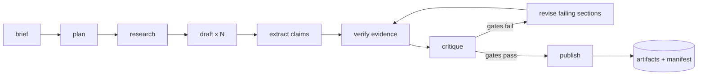

# DraftProof

**Evidence-first, evaluation-driven publishing.** DraftProof plans a technical article, researches it, drafts it in parallel, verifies every claim against its cited source, scores the result against a weighted rubric, revises the sections that fail, and publishes a set of artifacts with a full provenance manifest.

[](https://github.com/abubakarsiddique360/draftproof/actions/workflows/ci.yml)
[](https://github.com/abubakarsiddique360/draftproof/actions/workflows/codeql.yml)
[](LICENSE)
[](pyproject.toml)
[](https://docs.astral.sh/ruff/)
[](https://mypy-lang.org/)
[](#development)

---

> Most "AI writing" tools produce fluent text and hope. DraftProof refuses to publish without evidence: every factual claim must resolve to a source that is reachable, and the draft must clear a deterministic rubric before it is marked publishable. When it cannot, it says so — in the article, in the UI and in the manifest.

## Why it exists

LLM writing pipelines usually stop at "the text looks good". That is not a quality signal. DraftProof treats an article as an engineered artifact with a contract:

| Question | How DraftProof answers it |
| --- | --- |
| Is the plan sensible? | An explicit outline with goals, key points and word budgets |
| Where did the facts come from? | Sanitised evidence pack, canonical URLs, content hashes |
| Are the citations real? | Deterministic verification: fetch the URL, compare claim terms with source text |
| Is the writing any good? | Eight weighted metrics and hard publish gates |
| What did it cost? | Per-run token, call and USD accounting with a budget ceiling |
| Can I trust the output? | `manifest.json` records models, evidence, verdicts, scores and artifact digests |

## Features

- **Eight-stage pipeline** — brief → plan → research → draft → claims → verify → critique → revise → publish, each checkpointed and resumable.
- **Verified citations, not prompt wishes.** Claims are extracted, linked to evidence, then checked against fetched (or bundled) source text. Unsupported claims are flagged per section.
- **Weighted quality rubric** with hard gates and automatic, bounded revision of only the failing sections.
- **Provider-agnostic gateway** — offline `mock`, any OpenAI-compatible endpoint (OpenAI, Groq, Ollama, LM Studio, vLLM, OpenRouter) and Anthropic. Per-run retries, exponential backoff, circuit breaker, fallback chain and cost ledger.
- **Offline-first demo.** A deterministic mock provider plus a bundled corpus lets the full pipeline run — including verification and scoring — with no API key and no network.
- **Crash-safe storage.** SQLite with WAL, versioned migrations, stage checkpoints and a replayable event log. No external database required.
- **Live studio UI.** Dependency-free ES-module front end streaming over SSE: outline, per-section claim verdicts, metric bars, artifacts and the provenance manifest.
- **Human-in-the-loop.** `awaiting_review`, approve, request changes, or regenerate a single section — each re-verifies and re-scores.
- **Publishing outputs.** Markdown with front matter, self-contained HTML, JSON-LD, a social pack, the quality report, the outline and the manifest.
- **Security by default.** SSRF-safe fetching (private/loopback/link-local blocked, redirects revalidated, byte caps), HTML allow-list sanitisation, prompt-injection quarantine, constant-time API keys, rate limiting, body-size caps, secret-free provenance.
- **Evaluation harness.** Golden cases with explicit expectations, scored by `draftproof eval` and gated in CI.

## Quick start

```bash
git clone https://github.com/abubakarsiddique360/draftproof.git
cd draftproof
python -m venv .venv
source .venv/bin/activate      # Windows: .\.venv\Scripts\Activate.ps1
pip install -e ".[dev]"
```

Run the offline demo — no API key, no network, deterministic:

```bash
draftproof demo
```

You get a scored run in `demo-output/`:

```text
demo-output/
├── article.md          # publish-ready Markdown with front matter
├── article.html        # self-contained page (no external assets)
├── article.jsonld.json # schema.org Article
├── social.json         # X thread + LinkedIn copy
├── outline.json        # the plan
├── quality.json        # rubric scores and issues
└── manifest.json       # provenance: evidence, verdicts, hashes
```

Start the studio:

```bash
draftproof serve --provider mock
# open http://127.0.0.1:8000
```

Use a real model:

```bash
export DRAFTPROOF_PROVIDER=groq
export DRAFTPROOF_MODEL=llama-3.3-70b-versatile
export DRAFTPROOF_API_KEY=...            # or GROQ_API_KEY
export DRAFTPROOF_RETRIEVER=tavily
export DRAFTPROOF_TAVILY_API_KEY=...
draftproof run --topic "Vector index trade-offs" --words 1400
```

## How it works



| Stage | What it does | Fails when |
| --- | --- | --- |
| `brief` | Validates the brief, records run policy | Brief invalid |
| `plan` | Structured outline: goals, key points, word budgets | Fewer than 3 usable sections |
| `research` | Retrieves, canonicalises, dedupes, sanitises evidence | Never fatal — an empty evidence pack is reported |
| `draft` | Parallel section writers, each given only relevant evidence | Model output unparsable or too short |
| `claims` | Extracts checkable claims with evidence ids | — |
| `verify` | Resolves each cited source and scores textual support | — (verdicts are data, not errors) |
| `critique` | Computes the rubric and applies gates | Gates reported as failed |
| `revise` | Re-drafts only failing sections with fix directives, up to a limit | Budget exhausted |
| `publish` | Renders artifacts, writes the manifest, closes the run | Rendering error |

### Claim verification

Verification is deliberately **not** a model call:

1. The writer cites evidence ids, e.g. `([Trace design](https://docs.example.com/observability))`.
2. The claims stage extracts standalone claim sentences and the evidence ids they rely on.
3. The verifier resolves each source (HTTP fetch or bundled corpus), strips markup, quarantines instruction-like text, and computes a weighted term-support score.
4. A claim is `verified` only when the source is reachable **and** support ≥ the configured threshold. Otherwise the claim keeps a machine-readable reason: `no citation attached`, `cited source is unreachable`, `weak textual support (0.11 < 0.18)`.

Section grounding is then the share of verified claims, which feeds both the rubric and the UI.

### The quality contract

| Metric | Weight | What it measures |
| --- | ---: | --- |
| `structure` | 0.18 | Headings, substance, lists/code, placeholders, fence balance |
| `readability` | 0.14 | Flesch reading ease against a target band (40–65) |
| `citation_coverage` | 0.18 | Verified claims ÷ total claims |
| `repetition` | 0.10 | Duplicate 12-word passages and duplicate sentences across sections |
| `code_validity` | 0.10 | `ast.parse` for Python, `json.loads` for JSON, bracket balance otherwise |
| `word_budget` | 0.12 | Distance from the requested length |
| `seo` | 0.08 | Title/description lengths, tags, topic keywords in headings |
| `hedging` | 0.10 | Hedge words per 100 words |

Default gates: total score ≥ 75, structure ≥ 70, word budget ≥ 60, repetition ≥ 60, code validity ≥ 90, readability ≥ 40, and citation coverage ≥ 70 whenever the brief requests sources. Weights, gates and the readability band can be overridden with a YAML rubric (`load_rubric`).

Every failing metric becomes an `Issue` with an actionable directive, which is exactly what the revision stage consumes — there is one source of truth for "what is wrong" and "what to do about it".

## CLI

```bash
draftproof version
draftproof doctor                  # configuration, storage, provider and budget checks
draftproof demo                    # offline end-to-end run
draftproof run -t "Topic" --words 1400 --json
draftproof list
draftproof show <run-id>
draftproof approve <run-id> --notes "ship it"
draftproof export <run-id> --out export/
draftproof eval --cases evals/cases
draftproof serve --host 127.0.0.1 --port 8000
```

## HTTP API

| Method | Path | Purpose |
| --- | --- | --- |
| `GET` | `/api/v1/health` | Liveness, version, database status |
| `GET` | `/api/v1/meta` | Provider chain, retriever, verification mode, limits |
| `GET` | `/api/v1/rubric` | Active weights and gates |
| `GET` | `/api/v1/metrics` | Prometheus text counters |
| `POST` | `/api/v1/runs` | Queue a run (202) |
| `GET` | `/api/v1/runs` | Paginated run list |
| `GET` | `/api/v1/runs/{id}` | Full run record |
| `DELETE` | `/api/v1/runs/{id}` | Request cancellation |
| `POST` | `/api/v1/runs/{id}/resume` | Resume from the last checkpoint |
| `GET` | `/api/v1/runs/{id}/events` | SSE stream (`?after=<seq>` for replay) |
| `GET` | `/api/v1/runs/{id}/artifacts/{kind}` | Download an artifact |
| `POST` | `/api/v1/runs/{id}/review` | Approve or request changes |
| `POST` | `/api/v1/runs/{id}/sections/{sid}/regenerate` | Rewrite one section |

Interactive documentation is served at `/api/docs`.

## Configuration

All settings use the `DRAFTPROOF_` prefix and can come from the environment or a `.env` file.

| Variable | Default | Notes |
| --- | --- | --- |
| `DRAFTPROOF_PROVIDER` | `mock` | `mock`, `openai`, `groq`, `ollama`, `openrouter`, `anthropic` |
| `DRAFTPROOF_MODEL` | preset | Overrides the provider default model |
| `DRAFTPROOF_FALLBACK_PROVIDERS` | empty | Comma separated, tried in order |
| `DRAFTPROOF_BASE_URL` | preset | Custom OpenAI-compatible endpoint |
| `DRAFTPROOF_API_KEY` | — | Primary provider key (or use the provider's own env var) |
| `DRAFTPROOF_MAX_RETRIES` | `2` | Transient failure retries per provider |
| `DRAFTPROOF_CONCURRENCY` | `4` | Parallel section writers |
| `DRAFTPROOF_MAX_COST_USD` | `1.0` | Hard per-run budget |
| `DRAFTPROOF_MAX_REVISION_ATTEMPTS` | `2` | Bounded revision loop |
| `DRAFTPROOF_RETRIEVER` | `local_corpus` | `local_corpus`, `tavily`, `none` |
| `DRAFTPROOF_TAVILY_API_KEY` | — | Required for `tavily` |
| `DRAFTPROOF_VERIFICATION` | `auto` | `auto`, `live`, `corpus`, `off` |
| `DRAFTPROOF_EVIDENCE_LIMIT` | `8` | Sources kept per run |
| `DRAFTPROOF_ALLOWED_DOMAINS` / `_BLOCKED_DOMAINS` | empty | Comma separated host filters |
| `DRAFTPROOF_SERVICE_API_KEY` | — | Enables `X-API-Key` auth on `/api/v1` |
| `DRAFTPROOF_RATE_LIMIT_PER_MINUTE` | `60` | Per-client token bucket |
| `DRAFTPROOF_REVIEW_REQUIRED` | `false` | Stop at `awaiting_review` |
| `DRAFTPROOF_DATA_DIR` | `data` | SQLite database and artifacts |

Provider credentials can also come from `OPENAI_API_KEY`, `GROQ_API_KEY`, `OPENROUTER_API_KEY` or `ANTHROPIC_API_KEY`.

`DRAFTPROOF_VERIFICATION=auto` uses the bundled corpus for `local_corpus` and live HTTP for `tavily`.

## Project layout

```text
draftproof/
├── src/draftproof/
│   ├── api/            # FastAPI app, routes, SSE, auth, metrics, run manager
│   ├── domain/         # Pydantic models and typed errors
│   ├── export/         # Markdown, HTML, JSON-LD, social, manifest, sanitiser
│   ├── pipeline/       # context, stages, executor, service, prompts, parsing
│   ├── providers/      # base protocol, mock, OpenAI-compatible, Anthropic, router
│   ├── quality/        # metrics, rubric, evaluator
│   ├── research/       # retrievers, URL policy, fetcher, verifier, guard
│   ├── storage/        # SQLite, migrations, repository, artifact store
│   ├── web/            # studio UI (ES modules, CSS, node tests)
│   ├── cli.py          # Typer CLI
│   └── evaluation.py   # golden-case harness
├── tests/              # unit + integration (pytest, 88% coverage)
├── evals/cases/        # golden cases
└── docs/               # documentation site
```

## Development

```bash
make lint        # ruff check
make fmt         # ruff format
make typecheck   # mypy --strict
make test        # pytest
make cov         # pytest with coverage (fails under 80%)
make web-test    # node --test on the front-end modules
make docs        # mkdocs build --strict
make check       # lint + typecheck + tests + web tests
```

CI runs the suite on Python 3.11, 3.12 and 3.13, plus CodeQL, a wheel/sdist build, a docs build and a Docker build.

## Docker

```bash
docker build -t draftproof .
docker run --rm -p 8000:8000 -v draftproof-data:/data draftproof
# or
docker compose up --build
```

The image runs as a non-root user, writes to `/data`, and exposes a health check at `/api/v1/health`.

## Design decisions and honest limits

- **Verification measures textual support, not truth.** A claim can be well-supported by a wrong source. DraftProof makes support visible and auditable; it does not adjudicate reality.
- **The offline corpus is a fixture.** `local_corpus` ships original, clearly-labelled sample documents under `docs.example.com` so demos and tests are deterministic. It is not a web index.
- **The mock provider is a fixture too.** It exists to exercise the pipeline (schema synthesis, prose, citations), not to write your article. Scores from mock runs are only meaningful as regression signals.
- **Rate limiting is per process.** Multi-replica deployments should also enforce a shared limit at the edge.
- **Cancellation is cooperative** and local to the process running the pipeline.
- **SQLite is deliberate.** It keeps the project dependency-free and reproducible; the repository layer is the seam for a Postgres adapter.

## Roadmap

- Optional LLM critic as a *second opinion* alongside the deterministic rubric
- Postgres repository adapter and shared rate limiting
- Multi-language rubrics (readability metrics per language)
- Diff-based section edits in the studio
- Scheduled "refresh this article" runs with drift detection

## Contributing

Issues and pull requests are welcome. Please read [CONTRIBUTING.md](CONTRIBUTING.md) and [CODE_OF_CONDUCT.md](CODE_OF_CONDUCT.md). Security reports should follow [SECURITY.md](SECURITY.md).

## License

MIT © 2026 ABU BAKAR SIDDIQUE. See [LICENSE](LICENSE).
