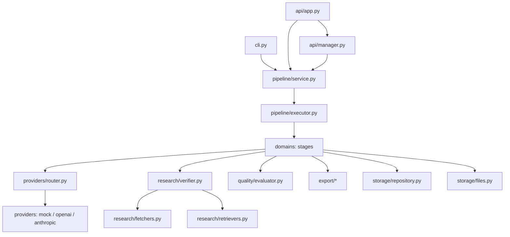
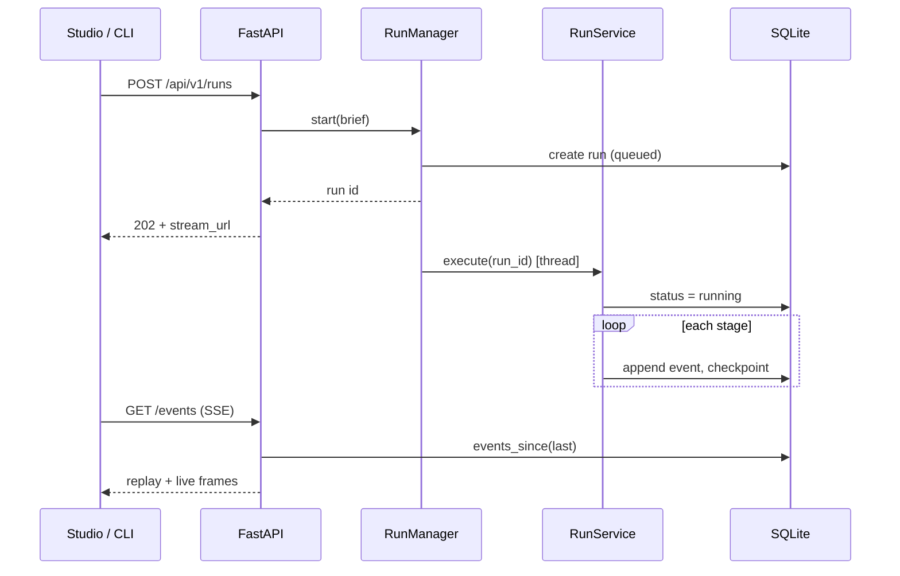

# Architecture

## Layers

| Package | Responsibility | Depends on |
| --- | --- | --- |
| `domain` | Pydantic models and typed errors | nothing |
| `config` | Environment-driven settings | domain |
| `providers` | Model protocol, implementations, resilient router | domain, config |
| `research` | Retrieval, URL policy, safe fetching, verification | domain, config |
| `quality` | Pure measurements, rubric, evaluation | domain, research.text |
| `export` | Markdown, HTML, JSON-LD, social, manifest | domain, quality |
| `storage` | SQLite, migrations, repository, artifact store | domain |
| `pipeline` | Context, stages, executor, service | all of the above |
| `api` | HTTP surface, SSE, auth, metrics, run manager | pipeline |
| `web` | Studio UI (ES modules, no build step) | HTTP API only |

The dependency direction is deliberate: `domain` knows nothing, `pipeline` orchestrates, and the outer layers (API, CLI, web) never contain business rules.

## Request lifecycle

The event log is the transport-neutral contract between the pipeline and every client. The CLI renders the same events the browser receives, and `?after=<seq>` makes the stream replayable after a reload.

## Concurrency model

- Pipeline stages run sequentially inside one worker thread per run.
- Section drafting and claim extraction fan out with a bounded `ThreadPoolExecutor` (`DRAFTPROOF_CONCURRENCY`).
- Storage uses a single SQLite connection guarded by a re-entrant lock. Writes are short and serialised; readers never see partial state because every mutation is a transaction.
- The router owns its own locks: the usage ledger and the circuit breaker are safe to call from parallel writers.

## Storage schema

| Table | Purpose |
| --- | --- |
| `runs` | Brief, status, provider/model, outline, quality JSON, usage |
| `sections` | Plan, markdown, attempt, status, grounding |
| `claims` | Extracted claim, evidence ids, verdict, confidence, note |
| `evidence` | Source metadata, verification status, content hash, overlap |
| `stages` | Per-stage timing and outcome (attempt aware) |
| `checkpoints` | Completed stages, used by resume |
| `events` | Append-only log for SSE replay |
| `artifacts` | Kind, relative path, sha256, size |
| `reviews` | Human approvals and change requests |

Migrations live in `src/draftproof/storage/migrations/` and are applied in filename order inside a transaction, tracked by `schema_migrations`.

## Why SQLite

An external database would make the project harder to run, not better. SQLite in WAL mode gives atomic writes, crash safety and zero configuration, and the repository class is the only place that knows SQL — swapping in Postgres means implementing the same interface.

## Failure philosophy

| Failure | Behaviour |
| --- | --- |
| Retrieval fails | Recorded as a warning; the run continues with an empty evidence pack |
| A citation is unreachable | The claim is not verified, with a reason; the run continues |
| Quality gates fail after revisions | The run completes, marks `passed: false` and says which gates failed |
| Provider is down | Retries, then falls back; if every provider fails the run is `failed` with a hint |
| Budget exhausted | The run stops cleanly and keeps the best draft it has |
| Process dies mid-run | Checkpoints allow `resume`, which skips completed stages |
