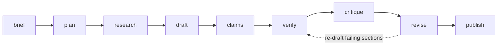

# Pipeline

Every run executes one ordered pipeline. Stages are functions over a mutable `PipelineContext`; the executor adds timing, events, errors and checkpoints.



## Stage reference

### `brief`

Validates the brief, records policy and warns when sources are required but research is disabled. Emits a `log` event with the content type, audience and target length.

### `plan`

Calls the planner with a JSON schema and normalises the result:

- section ids are reassigned as `s1..sn`
- titles, goals and meta description are padded or trimmed into valid ranges
- `requires_evidence` is forced on when the brief asks for sources
- fewer than three usable sections is a hard error (`InvalidModelOutputError`)

The outline is persisted immediately, so a crash after planning is recoverable.

### `research`

Builds up to six queries from the topic, the outline title and section titles, then:

1. retrieves candidate documents per query,
2. canonicalises URLs (tracking parameters, fragments, default ports, trailing slashes),
3. deduplicates by canonical URL, keeping the highest score,
4. applies `allowed_domains` / `blocked_domains`,
5. strips markup, removes instruction-like text and flags it (`injection_suspected`),
6. assigns stable ids (`ev1`, `ev2`, …) and caps the pack at `evidence_limit`.

Retriever failures are warnings, never fatal.

### `draft`

Each section is drafted independently, in parallel, with only the evidence relevant to that section (ranked by term overlap with its title and key points). The writer is told the exact heading, goal, key points, word budget, whether code is required and how to cite.

The output is normalised: fences removed, a leading `H1` removed, a missing `## Title` inserted, and drafts under 80 characters rejected.

### `claims`

Claims are extracted per section with a schema-constrained call and validated against the evidence catalogue: unknown evidence ids are dropped, claim ids are namespaced (`s1c1`), and at most six claims per section are kept.

### `verify`

See [Verification](verification.md). Inputs: evidence + claims. Outputs: per-evidence status, per-claim verdict and confidence, per-section grounding.

### `critique`

Computes the rubric and records the report. Failing gates become `Issue` objects with an actionable `directive`.

### `revise`

While gates fail and attempts remain:

1. choose the failing sections (or all of them when the issue is global),
2. re-draft just those sections with the directives as extra instructions and the previous draft as context,
3. re-extract claims for those sections,
4. re-verify all claims,
5. re-score.

The loop stops when the report passes, the attempt budget is exhausted, or the provider/budget raises — in which case the run continues with the best draft it has and records a warning.

### `publish`

Renders every artifact, writes the manifest (which includes the hashes of the other artifacts), stores the artifact rows and closes the run as `completed` or `awaiting_review`.

## Checkpoints and resume

After each successful stage the executor writes `checkpoints(run_id, stage)` and a `stage_finished` event. `resume` rebuilds the context from the database and skips any stage whose checkpoint exists, so a resumed run never repeats model calls it already paid for.

## Cancellation

`DELETE /api/v1/runs/{id}` (or `RunService.cancel`) sets a `threading.Event` shared with the running context. Stages and the revision loop call `context.check_cancelled()` at safe points; cancellation marks the run `cancelled` rather than failed.

## Events

| Event | Emitted by | Useful payload |
| --- | --- | --- |
| `run_started` | service | provider, model, resume flag |
| `stage_started` / `stage_finished` | executor | stage, attempt, duration |
| `log` | any stage | message, level |
| `warning` | any stage | message |
| `outline_ready` | plan | title, sections |
| `evidence_ready` | research | count, candidates, items |
| `section_ready` | draft | section id, words, attempt |
| `claims_ready` | claims | section id, count |
| `verification_ready` | verify | verified/total, coverage |
| `quality_scored` | critique/revise | score, grade, metrics, issues |
| `revision_started` / `revision_finished` | revise | attempt, sections, score |
| `artifact_written` | publish | kind, bytes, sha256 |
| `usage` | executor | tokens, calls, cost |
| `run_finished` | publish/service | status, score, artifacts, warnings |

## Writing a custom stage

```python
from draftproof.pipeline.executor import Pipeline, Stage, default_stages


def publish_to_cms(context) -> None:
    markdown = context.artifacts.read_text(context.run_id, "markdown")
    # ... push markdown somewhere
    context.sink.emit("log", {"stage": "cms", "message": "published"})


stages = [*default_stages(), Stage("cms", publish_to_cms)]
Pipeline(stages).execute(context)
```

Stages receive the context and must be idempotent if you want resume to be safe after them.
