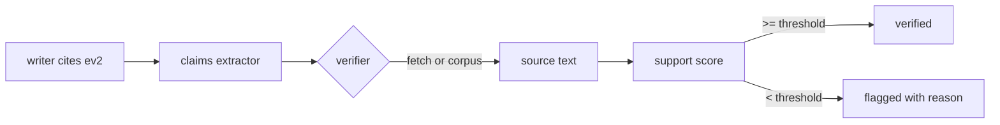

# Verification

DraftProof treats citation checking as a data problem, not a prompt problem. Asking a model to "cite sources" produces syntax; verification produces evidence.

## The chain



### 1. Evidence ids, not raw URLs

Writers receive a numbered catalogue:

```text
Evidence (cite these when a paragraph needs support):
- ev1 | Evaluating retrieval-augmented generation systems | https://docs.example.com/rag/evaluating...
- ev2 | Vector index trade-offs: HNSW, IVF and flat search | https://docs.example.com/vector-search/index-trade-offs
```

They are instructed to cite with Markdown links, using only those URLs. Unknown URLs are a policy violation; the claims stage additionally drops any evidence id that is not in the catalogue.

### 2. Claim extraction

For each section the extractor returns standalone sentences plus the evidence ids they rely on:

```json
{
  "claims": [
    {
      "text": "Retrieval recall should be measured with a labelled question set on every prompt change.",
      "evidence_ids": ["ev1"]
    }
  ]
}
```

### 3. Deterministic support scoring

For every claim, the verifier:

1. resolves each cited source (live HTTP fetch, or lookup in the trusted corpus index),
2. strips markup and quarantines instruction-like text,
3. computes a weighted term-support score between the claim and the source text:

```text
score = Σ len(term) for terms shared by claim and source
        ────────────────────────────────────────────────
        Σ len(term) for the 12 longest claim terms
```

Longer, rarer terms count more; the denominator is capped so a long claim is not penalised for being long.

4. marks the claim verified only when the source is `verified` **and** the score clears `DRAFTPROOF_VERIFICATION_MIN_OVERLAP` (default `0.18`).

### 4. Verdicts carry reasons

| Note | Meaning |
| --- | --- |
| `no citation attached` | The claim makes an external assertion but cites nothing |
| `cited source is unreachable` | DNS/HTTP failure, 404 or transport error |
| `cited source is blocked` | 401/403/405/429 or a blocked domain |
| `weak textual support (0.11 < 0.18)` | The source exists but does not support the claim |
| `cited evidence was not retrieved` | The id was dropped or never stored |

Section grounding is `verified claims ÷ claims`. It appears in the UI, the quality report and the manifest.

## Two verification modes

### `corpus` (offline)

Evidence is resolved against an in-memory index of the bundled corpus. This keeps demos, tests and CI fully deterministic while still exercising the verification logic. The Markdown and HTML exports state clearly that verification used the offline corpus.

### `live` (network)

Each cited URL is fetched through `SafeFetcher`:

| Control | Value |
| --- | --- |
| Schemes | `http`, `https` only |
| Credentials in URL | rejected |
| Hosts | `localhost`, `*.local`, `*.internal`, `*.home.arpa`, `.onion` rejected |
| Addresses | private, loopback, link-local, multicast, reserved and unspecified rejected |
| Redirects | at most 3, each hop revalidated against the same policy |
| Size | `DRAFTPROOF_FETCH_MAX_BYTES` (default 200 kB) |
| Time | `DRAFTPROOF_FETCH_TIMEOUT` (default 8 s) |
| Content type | text/json/xml only; everything else is `non_text` |

This is an SSRF boundary: the URLs come from search results, which are attacker-influenced.

## Prompt-injection defence

Retrieved text is never trusted. Before it reaches a model or a report:

- `<script>`/`<style>` blocks and markup are removed,
- length is capped,
- instruction-like phrases (`ignore previous instructions`, `system:`, chat control tokens, `### instructions`, …) are replaced with `[removed instruction text]`,
- the evidence is flagged `injection_suspected: true`,
- prompts wrap evidence in `<evidence id="evN">…</evidence>` and state that the content is untrusted data.

The manifest lists every flagged source so an editor can review it.

## Testing verification

```bash
python -m pytest tests/unit/test_verifier.py tests/unit/test_research.py
```

The suite covers supported claims, missing citations, weak support, blocked domains, unreachable sources, redirect-to-private-address attacks, non-text responses, byte caps and injection payloads — all without touching the network.
